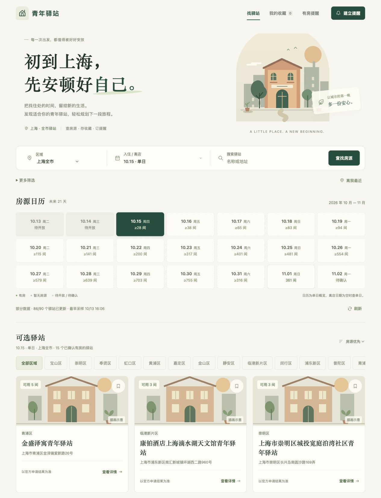
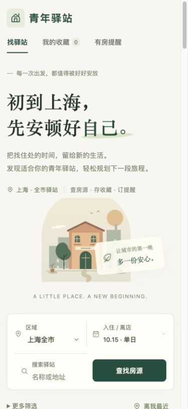

# 青年驿站 · 上海

初到上海，先安顿好自己。查房源、存收藏，有房时收到邮件提醒。

**[在线使用 ↗](https://youth-inn-finder.imshunsukez.workers.dev)** · [本地开发](docs/development.md) · [API](docs/api.md)

手机、电脑打开链接即可查房，无需注册或安装。

线上实拍于 2026-10-13，房源数量仅代表截图时的查询结果；卡片配图为插画示意。

查看手机界面

  

## 可以做什么

- **按日期找房**：未来 21 天日历，支持单日与连续入住查询。
- **快速筛选**：按区域、关键词、房源类型和余房数量查找；授权定位后可按直线距离排序。
- **收藏驿站**：保存在当前浏览器，方便下次查看。
- **有房提醒**：关闭网页后仍由后台检查，通过邮件通知。
- **前往官网申请**：查看官方详情，申请与审核由官网处理。

## 有房提醒

目前为免费邀请内测，首批共 **5 人，每人最多 2 条提醒**。首次填写邀请码和邮箱，验证后启用；通过邮件中的专属链接修改、暂停或取消，无需注册账户。

单日可关注全市，连续入住提醒需选定一个驿站。计划每 15 分钟检查；首次有符合条件的房源时提醒，持续有房不重复，明确无房后再次有房才重新提醒。

## 使用说明

数据来自[上海青年驿站](https://qnyz.shyouth.net/TWYouthInnV2/static/onemap/index.html)公开查询接口。**待确认不等于无房**；部分结果只显示已知数量的下界，请结合页面采样时间查看，以官网申请结果为准。

免费内测期间，查询更新和邮件通知可能延迟，长期稳定性尚未验证。

## 许可

[Apache-2.0](LICENSE) © 2026 Shunsuke
